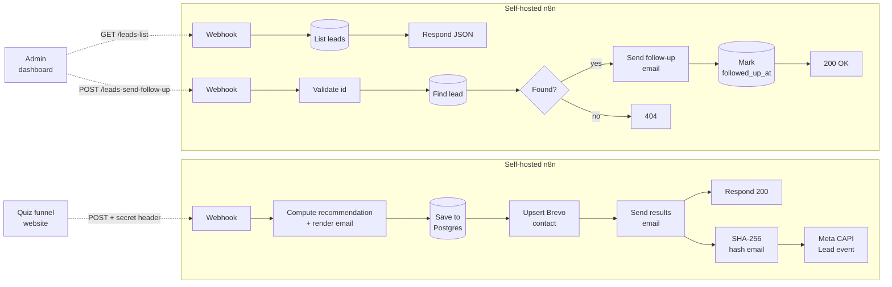
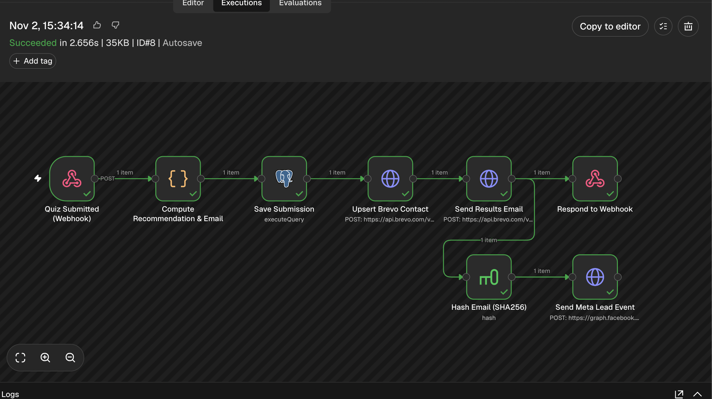
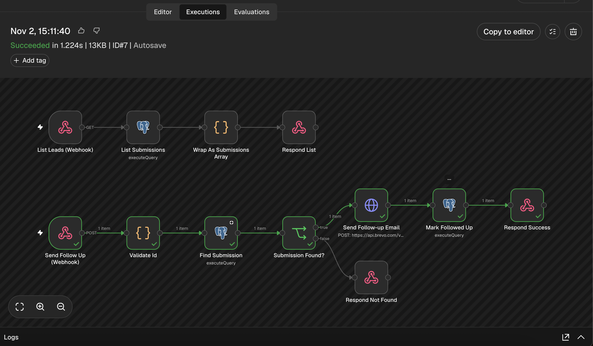

# Lead Funnel Automation on Self-Hosted n8n

A self-hosted n8n automation platform I deployed and secured for a client — an
online language-tutoring business that gets its leads from paid ads and a quiz
funnel. This repository is an **anonymized case study**: the workflows are the
real ones from the client's n8n instance, with the brand, contact details, IDs
and pricing replaced by placeholders (shown here as the fictional
*"Lingua Studio"*).

> Shared with the client's permission. No credentials, customer data or
> identifying business details are included.

**Status:** both workflows are active on the n8n server and were tested end to
end against the real services. They reproduce the existing serverless backend
and run in parallel with it. The live website and dashboard still use that
backend, and switching them over to n8n is a separate future step.

---

## The problem

The client runs Meta ads to a quiz: visitors answer a few questions about
their level, goals and availability, then receive a personalized lesson-plan
recommendation by email. The business needed:

1. Every quiz submission **stored**, **synced to the email CRM**, and answered
   with a **personalized results email** within seconds.
2. Ad-attribution that survives ad blockers and iOS tracking limits —
   a **server-side Meta Conversions API "Lead" event** for every submission.
3. A **leads dashboard backend**: list every lead and send a one-click,
   personal follow-up email to the ones who haven't booked yet, without
   double-sending.
4. All of it on a self-hosted server with hardened access and daily workflow
   backups.

## The solution

Dotted arrows show the intended callers. The endpoints are built and tested,
but the live site and dashboard are not connected to them yet.



### Workflow 1 — Quiz Results Email (8 nodes)

[`workflows/quiz-results-email.json`](workflows/quiz-results-email.json)



*Successful end-to-end test run: all 8 steps completed in 2.7 seconds.*

| Step | Node | What it does |
|---|---|---|
| 1 | Webhook (header-auth) | Receives the quiz submission; rejects requests without the shared secret |
| 2 | Code | Validates the email, maps answers → recommended plan, renders a responsive HTML email, builds CRM attributes |
| 3 | Postgres | Inserts the submission (`answers` stored as JSONB) with parameterized SQL |
| 4 | HTTP → Brevo | Upserts the contact into the CRM list with all quiz answers as attributes |
| 5 | HTTP → Brevo | Sends the transactional results email |
| 6 | Respond to Webhook | Returns the recommendation to the caller as JSON |
| 7–8 | Crypto → HTTP → Meta | SHA-256 hashes the normalized email and sends a server-side `Lead` event to the Conversions API, with the n8n execution id as `event_id` |

The recommendation logic and email template live in a single Code node,
also provided as a readable file:
[`workflows/code-nodes/compute-recommendation-and-email.js`](workflows/code-nodes/compute-recommendation-and-email.js).

### Workflow 2 — Leads Dashboard Backend (12 nodes)

[`workflows/leads-dashboard-backend.json`](workflows/leads-dashboard-backend.json)



*Successful test run of the follow-up endpoint with a disposable test lead. The
green path ran. The grey nodes are the separate list endpoint and the
"not found" response, which this request didn't trigger.*

Two authenticated endpoints in one workflow:

- **`GET /webhook/leads-list`** → returns the latest 500 leads as `{ submissions: [...] }`.
- **`POST /webhook/leads-send-follow-up`** `{ "id": 42 }` → validates the id,
  looks up the lead, sends a personal follow-up email, stamps
  `followed_up_at`, and returns `{ ok, followedUpAt }` — or a proper
  **404** when the lead doesn't exist.

See [`docs/api.md`](docs/api.md) for request/response examples.

---

## Engineering decisions

- **Self-hosted, with Postgres instead of SQLite.** Workflows, execution
  history and server configuration stay under direct control, on a fixed-size
  VPS with headroom to grow.
- **Every webhook is authenticated** with a header secret stored as an n8n
  credential — verified by testing that unauthenticated requests are rejected.
- **Parameterized SQL everywhere** (`$1, $2…` with `queryReplacement`) — no
  string-built queries from user input.
- **Input validation before side effects.** The email is validated and the
  id is type-checked before anything is written or sent.
- **Privacy-preserving ad attribution.** Emails are normalized and SHA-256
  hashed before leaving the system, as Meta's CAPI requires.
- **Built alongside production, not on top of it.** Both workflows replicate
  the existing serverless backend and were tested end-to-end against the real
  systems (with disposable test leads, cleaned up afterwards) without touching
  the live site.
- **Checked and tested before being called done.** Workflows were built with
  schema-aware n8n tooling and reviewed for configuration errors. Testing caught
  two bugs (a type-matching issue and a wrong response code), which were fixed.
- **Credentials never live in workflow JSON.** Exports only reference
  credentials by name, so workflow files are safe to version-control.

## Infrastructure

| Layer | Choice |
|---|---|
| Host | Hetzner Cloud VPS (2 vCPU / 4 GB), EU region, Ubuntu LTS |
| Runtime | Docker Compose: n8n + PostgreSQL 17 + Caddy |
| TLS | Caddy with automatic HTTPS certificates |
| Hardening | SSH key-only auth, root login disabled, non-root deploy user, UFW (22/80/443 only), fail2ban |
| Network | n8n and Postgres publish no ports; Caddy is the sole public entry point |
| Backups | Daily cron exports every workflow to a private Git repo via a repo-scoped deploy key — credentials are never exported |
| App database | Managed Postgres (Neon) shared with the website, `quiz_submissions` table |
| Email / CRM | Brevo (contacts API + transactional email) |

Details: [`docs/infrastructure.md`](docs/infrastructure.md) ·
anonymized server config in [`infra/`](infra/).

---

## Run it yourself

1. Start n8n (or use the Compose setup in [`infra/`](infra/)).
2. Create the table: [`database/schema.sql`](database/schema.sql).
3. In n8n, create these credentials:

   | Credential name | Type | Value |
   |---|---|---|
   | `Webhook Shared Secret` | Header Auth | header name + secret your site sends |
   | `Leads Dashboard Webhook Secret` | Header Auth | header name + secret your dashboard sends |
   | `Postgres — Leads DB` | Postgres | your database |
   | `Brevo API Key` | Header Auth | `api-key: <your Brevo key>` |
   | `Meta CAPI Access Token` | Query Auth | `access_token=<your token>` |

4. Import both files from [`workflows/`](workflows/) (*Workflows → Import from file*)
   and select your credentials on each node.
5. Replace the placeholders: `YOUR_PIXEL_ID` in *Send Meta Lead Event*,
   the `BRAND` block at the top of the Code node, the sender address, and
   the Brevo list id.
6. Activate, then send the sample payload:

   ```bash
   curl -X POST "$N8N_URL/webhook/quiz-results" \
     -H "Content-Type: application/json" \
     -H "X-Webhook-Secret: $SECRET" \
     -d @examples/quiz-submission.json
   ```

## Repository layout

```
workflows/
  quiz-results-email.json          # importable n8n workflow
  leads-dashboard-backend.json     # importable n8n workflow
  code-nodes/                      # Code-node source + email template, readable
database/schema.sql                # table used by both workflows
examples/                          # sample request/response payloads
docs/                              # API reference, infrastructure write-up, screenshots
infra/                             # anonymized Compose + Caddy config, example backup script
```

## Possible next steps

- Connect the live quiz and admin dashboard to these endpoints.
- Error-trigger workflow that alerts on any failed execution (Slack/email).
- Retry with backoff on the Brevo and Meta HTTP nodes.
- Automatic follow-up after N days without a booking, using the existing
  `followed_up_at` column as the idempotency guard.
